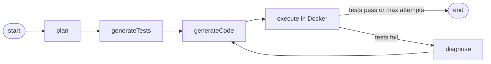

# Self-Heal Agent

An autonomous coding agent that turns a plain-English task into working, tested, self-correcting Python code.

You give it a task (e.g. *"Implement a thread-safe LRU cache"*). The agent plans the implementation, writes `pytest` tests, generates the code, runs the tests in an isolated Docker sandbox and if anything fails, diagnoses the failure and rewrites the code until the tests pass (or a retry limit is hit).

The whole loop is orchestrated as a [LangGraph4j](https://github.com/bsorrentino/langgraph4j) state graph, with a local LLM served by [Ollama](https://ollama.com) via [Spring AI](https://docs.spring.io/spring-ai/reference/).

---

## How it works

The agent is a directed graph of nodes. Each node reads from and writes to a shared `SelfHealState`, and the graph loops back to code generation after every failed test run.



| Node            | Responsibility                                                                                       |
| --------------- | ---------------------------------------------------------------------------------------------------- |
| `plan`          | Asks the LLM to break the task into a JSON implementation plan (functions, dependencies, edge cases). |
| `generateTests` | Writes a self-contained `pytest` suite (`test_solution.py`) from the plan.                           |
| `generateCode`  | Implements `solution.py` from the plan + tests. On retries, it also receives the failure output and diagnosis. |
| `execute`       | Runs the tests inside a disposable `python:3.12` Docker container.                                    |
| `diagnose`      | Explains each failing test and the exact code that must change, feeding the next code-generation attempt. |

The loop exits when the tests pass (the Docker run returns empty output) or when `MAX_ATTEMPTS` (10) is reached.

### Key components

| Area              | Location                              | Notes                                                        |
| ----------------- | ------------------------------------- | ------------------------------------------------------------ |
| State graph beans | `config/AgentConfig.java`             | Wires nodes, edges, and the conditional retry edge.          |
| Shared state      | `agent/SelfHealState.java`            | `task`, `plan`, `tests`, `code`, `failureOutput`, `diagnosis`, `attempt`. |
| Node actions      | `agent/*Node.java`                    | One class per graph node.                                    |
| Sandbox execution | `service/DockerExecutorService.java`  | Writes temp files, runs pytest in Docker with a 90s timeout. |
| REST API          | `controller/AgentController.java`     | Blocking and SSE streaming endpoints.                        |
| Extraction        | `agent/CodeExtractor.java`            | Pulls fenced code blocks out of LLM responses.               |

---

## Tech stack

- **Java 21** + **Spring Boot 3.3.5** (Web)
- **Spring AI 1.0.0-M6** with the Ollama starter
- **LangGraph4j 1.5.9** for graph orchestration
- **Ollama** with `qwen2.5-coder:7b` (configurable)
- **Docker** (`python:3.12`) as the test sandbox
- **Angular 22** + **Vitest** for the web UI
- Python CLI client (`client/agent_cli.py`) with no third-party dependencies

---

## Project layout

```
.
├── src/main/java/com/example/selfheal/
│   ├── SelfHealAgentApplication.java   # Spring Boot entry point
│   ├── agent/                          # Graph nodes, state, code extraction
│   ├── config/                         # Graph wiring, CORS
│   ├── controller/                     # REST + SSE endpoints
│   ├── dto/                            # AgentRequest / AgentResponse
│   └── service/DockerExecutorService   # Docker sandbox runner
├── src/main/resources/application.yml  # Ollama + model configuration
├── frontend/                           # Angular 22 single-page UI
├── client/agent_cli.py                 # Terminal client for the SSE stream
├── docker-compose.yml                  # Ollama service
└── pom.xml
```

---

## Prerequisites

- **JDK 21**
- **Maven 3.9+**
- **Docker** (running) -- the agent executes generated tests in containers
- **Ollama** -- either locally installed or via the provided `docker-compose.yml`
- **Node.js 20+** / **npm 11** -- only needed for the web UI

Pull the model used by the agent:

```bash
ollama pull qwen2.5-coder:7b
```

---

## Getting started

### 1. Start Ollama

Using Docker Compose:

```bash
docker compose up -d ollama
```

Or run a native Ollama instance if you already have one on `localhost:11434`.

### 2. Run the backend

```bash
mvn spring-boot:run
```

The API listens on `http://localhost:8080`.

### 3. (Optional) Run the web UI

```bash
cd frontend
npm install
npm start
```

Open `http://localhost:4200`. The dev server proxies `/agent` requests to the backend (`frontend/proxy.conf.json`).

---

## API

### `POST /agent/run`

Runs the agent to completion and returns a JSON summary.

```bash
curl -X POST http://localhost:8080/agent/run \
  -H 'Content-Type: application/json' \
  -d '{"task":"Implement a function that reverses a string"}'
```

Response (`AgentResponse`):

```json
{
  "success": true,
  "attempts": 1,
  "code": "def reverse_string(s):\n    return s[::-1]\n",
  "tests": "from solution import reverse_string\n...",
  "plan": "{ ... }",
  "finalOutput": ""
}
```

`finalOutput` holds the last pytest failure output when `success` is `false`.

### `POST /agent/run/stream`

Same run, streamed as Server-Sent Events. Each graph node is emitted as a `node` event (with the current `state`), followed by a final `result` event, or an `error` event.

```bash
curl -N -X POST http://localhost:8080/agent/run/stream \
  -H 'Content-Type: application/json' \
  -d '{"task":"Implement a function that reverses a string"}'
```

CORS is enabled for `http://localhost:4200` and `http://127.0.0.1:4200` (see `config/WebConfig.java`).

---

## Command-line client

A dependency-free Python client can drive the stream and render each phase:

```bash
./client/agent_cli.py "Implement a function that returns the nth Fibonacci number"
echo "Implement a function that reverses a string" | ./client/agent_cli.py
./client/agent_cli.py --plain "Implement a binary search"          # one-shot, no streaming
./client/agent_cli.py --url http://192.168.1.5:8080/agent/run/stream "..."
```

---

## Configuration

`src/main/resources/application.yml`:

```yaml
spring:
  ai:
    ollama:
      base-url: http://localhost:11434
      chat:
        options:
          model: qwen2.5-coder:7b
          temperature: 0.2
          num-ctx: 8192
```

Point `base-url` at a different Ollama host, or swap `model` for any code-capable model you have pulled.

Other tunables:

- `SelfHealState.MAX_ATTEMPTS` -- maximum generate → execute → diagnose iterations (default `10`).
- `DockerExecutorService.TIMEOUT_SECONDS` -- per-run sandbox timeout (default `90`).

---

## Testing

Backend tests use Spring Boot's test slice, Mockito, and a mocked `ChatClient` + Docker executor, so they need neither Ollama nor Docker:

```bash
mvn test
```

Coverage includes:

- `DockerExecutorServiceTest` -- success, failure output, and timeout handling.
- `GraphStructureTest` -- the graph bean is wired.
- `SelfHealAgentIntegrationTest` -- first-attempt success, success after a retry, graceful failure at max attempts, and SSE streaming.


```bash
cd frontend
npm test
```

---

## Notes & limitations

- The Docker sandbox currently uses the public `python:3.12` image and `pip install pytest` on each run. Pre-pull the image (`docker pull python:3.12`) to avoid the first-run delay.
- Generated code is only as good as the local model. A larger coder model will improve first-attempt success rates.
- The agent writes files to a temp directory and removes them afterward; no project files are modified.
